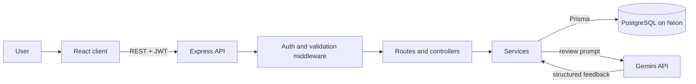
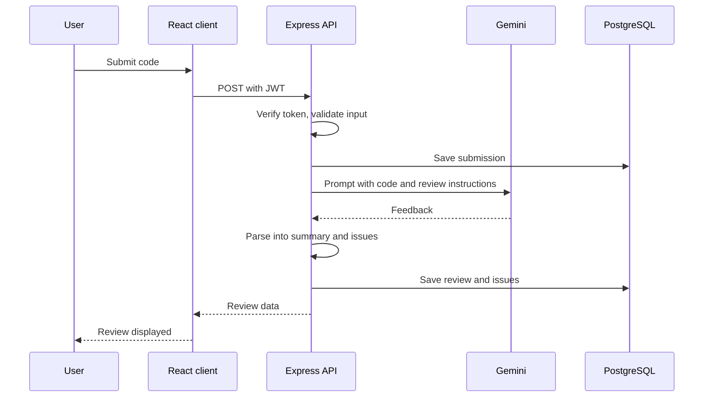
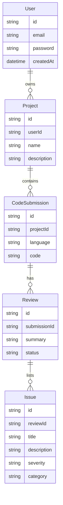

# AI Code Review System

> Submit your code, get structured AI feedback. Bugs, readability problems and improvement suggestions, saved per project so you can come back to them.

[**Live Demo**](https://code-review-ai-client.onrender.com) · [**Source Code**](https://github.com/sandhir-ishita/code-review-ai)

---

## Why this project exists

Code reviews are valuable, but finding bugs, readability issues and maintainability problems by hand is slow, and a solo developer often has no reviewer at all.

This project turns that into a simple flow: create a project, submit code, and receive a structured review made of a summary and individual issues, each with a severity and a category. Everything is stored, so past reviews can be revisited.

It was built to go beyond a thin API wrapper: a layered backend, a relational data model, authenticated access, validated input, and a deployed full-stack app.

---

## How it works

```
Register / Login  →  Create a project  →  Submit code  →  AI review is generated  →  Review + issues are saved and shown
```

1. **Authenticate**: register and log in. Passwords are hashed and sessions use JWT.
2. **Create a project**: organise your work; projects can be edited and deleted.
3. **Submit code**: choose a language and paste your source.
4. **Get a review**: the backend builds a prompt, sends it to the Gemini API, and turns the response into a structured review.
5. **Read the results**: a summary plus individual issues, each with a title, explanation, severity and category.

---

## Features

- Secure registration and login (bcrypt + JWT)
- Project creation, editing and deletion
- Code submission per project
- AI-generated review using the Gemini API
- Issues with severity and category attached to every review
- Persistent storage of projects, submissions, reviews and issues
- Request validation with Zod
- REST API with protected routes
- Deployed frontend and backend

---

## Tech stack

| Layer | Technology |
| --- | --- |
| Frontend | React |
| Backend | Node.js, Express |
| Database | PostgreSQL (Neon) |
| ORM | Prisma |
| AI | Gemini API |
| Auth | JWT, bcrypt |
| Validation | Zod |
| API testing | Postman |
| Hosting | Render |

---

## Architecture



The client talks to the Express API over REST. Middleware handles authentication and request validation before a request reaches the controllers. Services hold the business logic: they read and write through Prisma and call Gemini for the review.

### Review flow



---

## Database design

Five entities, managed through Prisma migrations.



---

## Security

- Passwords are hashed with bcrypt before storage
- JWT-based authentication protects user-specific routes
- Zod validates incoming request data
- Secrets live in environment variables, never in the repository or the frontend
- Prisma provides parameterised database access

---

## Running locally

### Prerequisites

- Node.js and npm
- A PostgreSQL database (a free Neon project works)
- A Gemini API key

### 1. Clone

```bash
git clone https://github.com/sandhir-ishita/code-review-ai.git
cd code-review-ai
```

### 2. Backend

```bash
cd server
npm install
```

Create `server/.env`:

```env
PORT=5000
DATABASE_URL=your_postgresql_connection_string
JWT_SECRET=your_jwt_secret
GEMINI_API_KEY=your_gemini_api_key
```

Set up the database and start the server:

```bash
npx prisma migrate dev
npx prisma generate
npm run dev
```

### 3. Frontend

In a second terminal:

```bash
cd client
npm install
npm run dev
```

If the client needs to know the API address, point it at `http://localhost:5000` using the environment variable your client reads.

---

## Deployment

| Part | Host |
| --- | --- |
| Client | Render |
| Server | Render |
| Database | Neon (managed PostgreSQL) |

CORS on the server is configured for the deployed client origin.

---

## Repository structure

```
code-review-ai/
├── client/    # React frontend
├── server/    # Express API, Prisma schema and migrations
└── docs/      # Requirements, system design, database design, API design, AI design, low-level design
```

The design documents in `docs/` explain the thinking behind the system before it was built.

---

## Design notes

- AI feedback is treated as assistance, not a guarantee of correctness.
- Reviews are stored as structured data (summary plus individual issues) rather than one block of text, so they can be filtered, counted and compared later.
- The backend is split into routes, controllers and services so that HTTP handling, business logic and AI integration stay separate.

---


## Author

**Ishita Sandhir**, Computer Science and Engineering student
GitHub: [sandhir-ishita](https://github.com/sandhir-ishita)

Built to explore AI integration, REST API design, relational data modelling and authentication in a deployed full-stack application.
