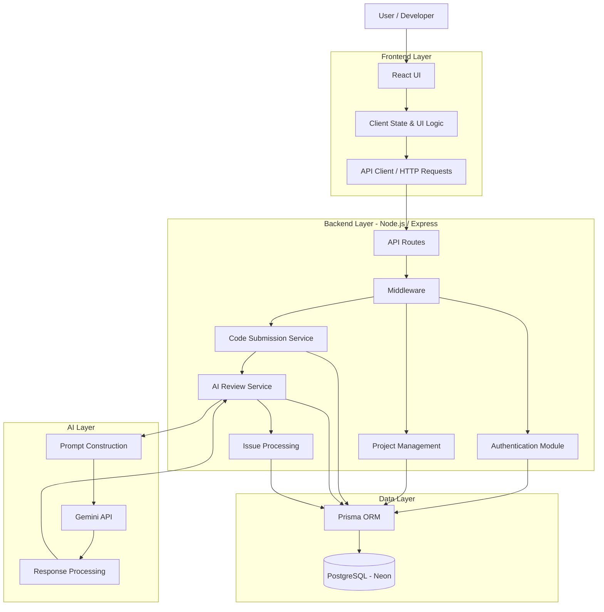
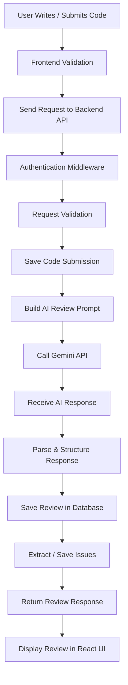
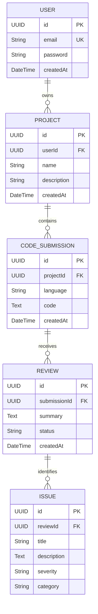
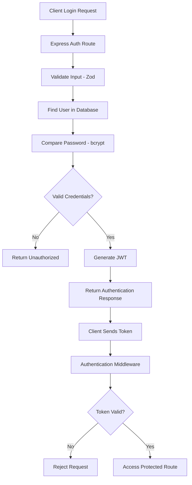
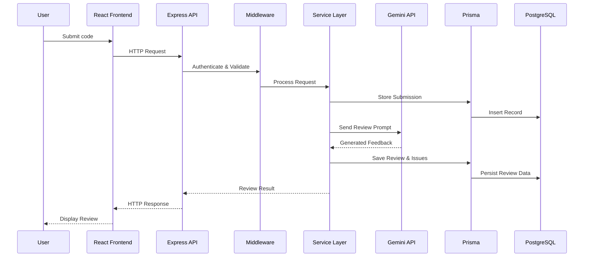
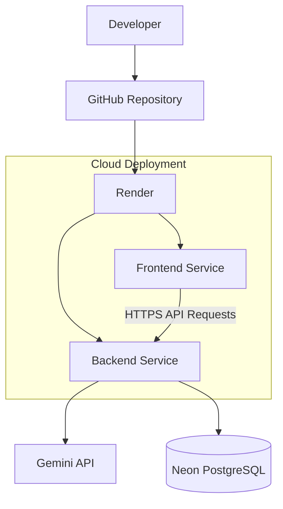

# AI Code Review System

An AI-powered code review platform that helps developers analyze their code, identify potential issues, understand code quality concerns, and receive AI-generated suggestions for improvement.

The application integrates a React frontend, Node.js and Express backend, PostgreSQL database, Prisma ORM, and Gemini API to build an AI-assisted code review workflow.

---

## 🚀 Live Demo

- **Live Application:** [View Live Demo](YOUR_RENDER_URL)
- **GitHub Repository:** [View Source Code](YOUR_GITHUB_URL)

---

## 📌 Overview

Code reviews are an important part of software development, but manually identifying bugs, readability issues, and potential improvements can be time-consuming.

The AI Code Review System aims to simplify this process by allowing users to submit code and receive structured AI-generated feedback.

The application handles authentication, project management, code submissions, AI review generation, database persistence, and review retrieval through a modular backend architecture.

---

## ✨ Features

- Secure user registration and login
- JWT-based authentication
- Project creation and management
- Code submission for AI analysis
- AI-powered code review using Gemini API
- Identification of potential bugs and code quality issues
- Suggestions for improving code readability and maintainability
- Persistent storage of submissions and review results
- Issue tracking associated with generated reviews
- RESTful API architecture
- Input validation using Zod
- Password hashing using bcrypt
- PostgreSQL database managed using Prisma ORM

---

## 🛠️ Tech Stack

| Layer | Technology |
|---|---|
| Frontend | React |
| Frontend Language | JavaScript |
| Backend Runtime | Node.js |
| Backend Framework | Express.js |
| API Style | REST API |
| Database | PostgreSQL (Neon) |
| ORM | Prisma |
| AI Integration | Gemini API |
| Authentication | JWT |
| Password Security | bcrypt |
| Validation | Zod |
| API Testing | Postman |
| Deployment | Render |
| Version Control | Git & GitHub |

---

# 🏛️ System Architecture

The application follows a client-server architecture with a modular backend. The frontend communicates with backend services through REST APIs. The backend handles authentication, business logic, database operations, and external AI integration.

## High-Level Architecture



### Architecture Components

| Component | Responsibility |
|---|---|
| React Frontend | User interaction, forms, code submission, and displaying reviews |
| API Client | Communicates with backend endpoints |
| Express Routes | Receives HTTP requests and maps them to application functionality |
| Middleware | Handles authentication, request validation, and shared request processing |
| Authentication Module | Registration, login, token generation, and access control |
| Project Management | Create and manage user projects |
| Code Submission Service | Stores and manages submitted source code |
| AI Review Service | Coordinates code analysis and AI response generation |
| AI Integration | Sends review prompts to Gemini and processes responses |
| Prisma ORM | Maps application operations to database queries |
| PostgreSQL | Stores users, projects, submissions, reviews, and issues |

---

# 🔄 AI Code Review Workflow

The system processes a code review through multiple stages.



### Workflow Explanation

1. The user submits code from the React frontend.
2. The request is sent to the Express backend.
3. Middleware validates the user's authentication.
4. The backend validates incoming data.
5. The submitted code is associated with the appropriate project and stored.
6. The AI review service constructs a prompt using the submitted code and review instructions.
7. The Gemini API processes the prompt and returns feedback.
8. The backend processes the AI response into the expected structure.
9. Review details and associated issues are persisted in PostgreSQL.
10. The backend returns the review data to the frontend.
11. The React interface displays the generated review.

---

# 🗃️ Database Design

The application uses PostgreSQL as its relational database and Prisma ORM for database access, schema management, and querying.

## Entity Relationship Diagram (ERD)

The conceptual database consists of five primary entities:

- User
- Project
- CodeSubmission
- Review
- Issue



<sub>Conceptual ERD. Field names, types, relation cardinalities and constraints should be reconciled with the actual Prisma schema before treating this as the final database specification.</sub>

## Database Entities

### 1. User

Stores registered user information and authentication details.

| Field | Description |
|---|---|
| id | Unique user identifier |
| email | User email address |
| password | Hashed password |
| createdAt | Account creation timestamp |

**Responsibilities:**
- Maintain user accounts
- Support authentication
- Associate projects with their owners

### 2. Project

Represents a project created and managed by a user.

| Field | Description |
|---|---|
| id | Unique project identifier |
| userId | Owner of the project |
| name | Project name |
| description | Project description |
| createdAt | Creation timestamp |

**Responsibilities:**
- Organize code submissions
- Associate submissions with a project
- Maintain project ownership

### 3. CodeSubmission

Stores source code submitted for review.

| Field | Description |
|---|---|
| id | Unique submission identifier |
| projectId | Associated project |
| language | Programming language |
| code | Submitted source code |
| createdAt | Submission timestamp |

**Responsibilities:**
- Persist submitted source code
- Track submission history
- Connect submissions with generated reviews

### 4. Review

Stores AI-generated review information.

| Field | Description |
|---|---|
| id | Unique review identifier |
| submissionId | Related code submission |
| summary | Overall review summary |
| status | Review processing status |
| createdAt | Review timestamp |

**Responsibilities:**
- Store AI-generated analysis
- Connect review results to submissions
- Provide review data to the frontend

### 5. Issue

Stores individual issues identified during a code review.

| Field | Description |
|---|---|
| id | Unique issue identifier |
| reviewId | Associated review |
| title | Issue title |
| description | Detailed explanation |
| severity | Issue severity |
| category | Issue classification |

**Responsibilities:**
- Represent individual findings
- Categorize potential code problems
- Provide detailed feedback for developers

---

## 🔗 Database Relationships

| Relationship | Description |
|---|---|
| User → Project | A user owns and manages projects |
| Project → CodeSubmission | A project can contain multiple submissions |
| CodeSubmission → Review | A code submission can have review records |
| Review → Issue | A review can identify multiple issues |

The relational structure allows the system to retrieve projects, submission history, review results, and associated issues using their relationships.

---

# 🔐 Authentication & Security Architecture

The application uses token-based authentication to protect user-specific resources.



### Security Mechanisms

- **Password Hashing:** bcrypt hashes passwords before storage.
- **JWT Authentication:** Token-based authentication for protected routes.
- **Request Validation:** Zod validates request data.
- **Protected Routes:** Authentication middleware verifies access.
- **Environment Variables:** Sensitive credentials are kept outside source code.
- **Database Access:** Prisma provides structured database access.

---

# 🔌 API Architecture

The frontend communicates with the backend through HTTP requests using a REST API structure.

## API Modules

| Module | Purpose |
|---|---|
| Authentication | Registration and login |
| Projects | Project creation and management |
| Code Submissions | Submit and retrieve code |
| Reviews | Generate and retrieve AI review results |
| Issues | Access issue details associated with reviews |

## API Request Lifecycle



<sub>Sequence shown is the intended review-processing flow; adjust if the current implementation uses different processing or persistence steps.</sub>

---

# 📁 Backend Structure

The backend is organized by responsibility to improve maintainability and separation of concerns.

```text
backend/
│
├── prisma/
│   ├── schema.prisma
│   └── migrations/
│
├── src/
│   ├── routes/
│   │   ├── auth.routes.js
│   │   ├── project.routes.js
│   │   ├── submission.routes.js
│   │   └── review.routes.js
│   │
│   ├── controllers/
│   │   ├── auth.controller.js
│   │   ├── project.controller.js
│   │   ├── submission.controller.js
│   │   └── review.controller.js
│   │
│   ├── services/
│   │   ├── auth.service.js
│   │   ├── project.service.js
│   │   ├── review.service.js
│   │   └── ai.service.js
│   │
│   ├── middleware/
│   │   ├── auth.middleware.js
│   │   └── validation.middleware.js
│   │
│   ├── validators/
│   │   └── request.validators.js
│   │
│   ├── utils/
│   │   └── helpers.js
│   │
│   ├── config/
│   │   └── database.js
│   │
│   └── app.js
│
├── .env
├── package.json
└── server.js
```

<sub>Illustrative modular structure. File and folder names should be updated to match the repository's actual structure.</sub>

---

# 🧠 AI Integration

The application integrates the Gemini API to analyze submitted source code.

## AI Review Process

1. Receive submitted source code from the backend.
2. Prepare a structured prompt containing review instructions and the code.
3. Send the request to the Gemini API.
4. Receive generated feedback.
5. Process the response into review data.
6. Store review results and issue details.
7. Return the review to the frontend.

## Review Objectives

The AI review is intended to help identify:

- Potential bugs
- Logical errors
- Code readability problems
- Maintainability concerns
- Inefficient implementation patterns
- Possible improvements and suggestions

AI-generated feedback should be treated as assistance rather than a guaranteed correctness assessment.

---

# ☁️ Deployment Architecture

The application uses cloud services for hosting and persistence.



### Deployment Components

| Service | Role |
|---|---|
| GitHub | Source code hosting and version control |
| Render | Application hosting and deployment |
| Frontend | React application delivery |
| Backend | Express API hosting |
| Neon | Managed PostgreSQL database |
| Gemini API | AI code review generation |

---

# ⚙️ Installation & Setup

## Prerequisites

- Node.js
- npm
- Git
- PostgreSQL database or Neon account
- Gemini API key

## 1. Clone the Repository

```bash
git clone YOUR_GITHUB_REPOSITORY_URL
cd code-review-ai
```

## 2. Backend Setup

```bash
cd backend
npm install
```

## 3. Configure Environment Variables

Create a `.env` file inside the backend directory.

```env
PORT=5000
DATABASE_URL=your_postgresql_connection_string
JWT_SECRET=your_jwt_secret
GEMINI_API_KEY=your_gemini_api_key
```

## 4. Database Setup

Run Prisma migrations:

```bash
npx prisma migrate dev
```

Generate Prisma Client if required:

```bash
npx prisma generate
```

## 5. Start the Backend Server

```bash
npm run dev
```

## 6. Frontend Setup

Open a separate terminal:

```bash
cd frontend
npm install
npm run dev
```

The frontend and backend should now be running locally according to their respective configurations.

---

# 🧪 Testing

API endpoints can be tested using Postman.

Testing areas include:

- User registration
- User login
- Authentication validation
- Project creation
- Project retrieval
- Code submission
- AI review generation
- Review retrieval
- Invalid request handling
- Unauthorized request handling

---

# 🔒 Environment Variables

| Variable | Description |
|---|---|
| `PORT` | Port on which backend runs |
| `DATABASE_URL` | PostgreSQL connection string |
| `JWT_SECRET` | Secret used to sign JWT tokens |
| `GEMINI_API_KEY` | Gemini API credential |

Never commit environment files or expose API credentials in the frontend or public repository.

---

# 🚧 Future Enhancements

- Support for additional programming languages
- Review severity filtering
- Review history and comparisons
- Code diff-based review
- Exportable review reports
- Improved issue classification
- Advanced code quality metrics
- Asynchronous review processing for large submissions

---

# 👩‍💻 Author

**Ishita Sandhir**

Computer Science & Engineering Student

GitHub: [sandhir-ishita](YOUR_GITHUB_PROFILE_URL)

---

*Developed to explore AI integration, REST API development, relational database design, authentication, and scalable software architecture.*
